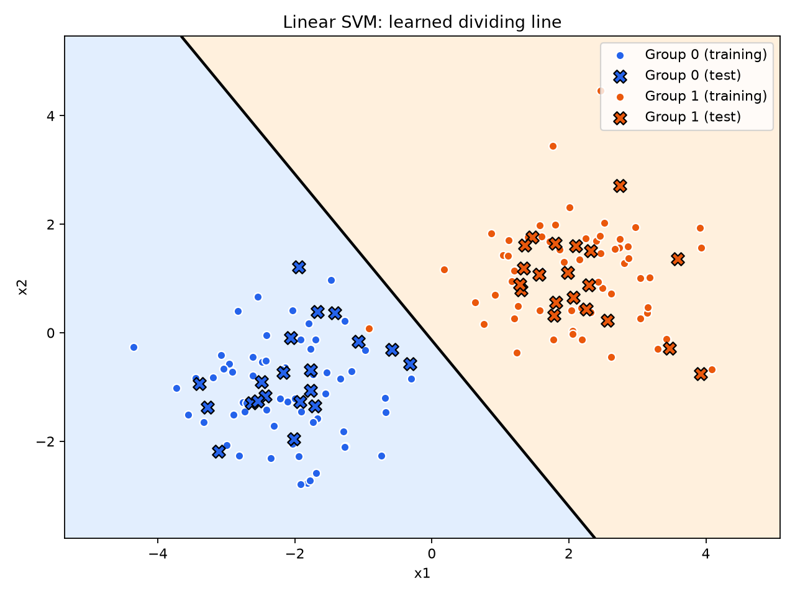

# Linear SVM in two dimensions

[SVM.py](SVM.py) generates two groups of points and learns a straight line that separates them. The model trains on 120 labeled points and predicts the groups of the remaining 40. Circles mark the training points, crosses mark the test points, and the background shows the predicted group on each side of the line.



## Run the example

Open a terminal in the project folder. On Windows with Python 3.11, run these commands in PowerShell or Command Prompt.

```powershell
py -3.11 -m venv .venv
.\.venv\Scripts\python.exe -m pip install -r requirements.txt
.\.venv\Scripts\python.exe SVM.py
```

The script prints the test accuracy and the predicted group for the point `[1.5, 1.0]`. It saves the plot as `svm_example.png` beside the script and opens a plot window. Add `--no-show` to save the image without opening the window.

## Experiment with the points

In the `make_blobs` call, change `centers` to move the groups or increase `cluster_std` to spread the points farther from their centers. The fixed seed (`random_state=42`) makes the example repeatable. Set it to `None` to generate new points on each run.
