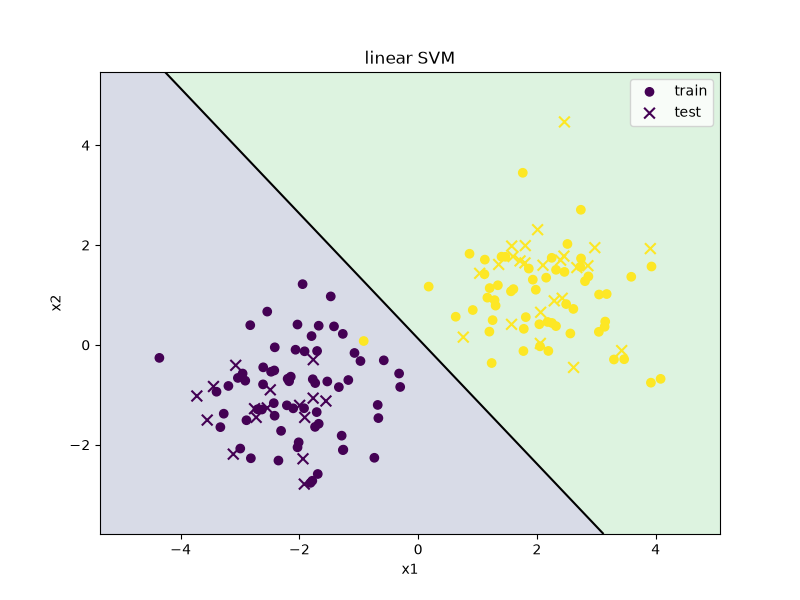

# svm-demo

A small example of training a linear SVM with scikit-learn on two clusters of points, then plotting the line that separates them.



Circles are training points, x's are test points. The black line is the decision boundary.

## Requirements

- Python 3.8+
- numpy
- matplotlib
- scikit-learn

## Setup

```
git clone https://github.com/YOUR-USERNAME/svm-demo.git
cd svm-demo
pip install -r requirements.txt
```

## Usage

```
python svm.py
```

This will:

- print the test accuracy
- print the predicted group for one new point, (1.5, 1.0)
- save the plot as `svm.png`
- open the plot in a window

On a machine with no display, run it with `MPLBACKEND=Agg python svm.py` and it will only save the image.

## How it works

1. `make_blobs` generates 160 random 2D points in two groups.
2. 25% of the points are held back for testing.
3. The features are scaled with `StandardScaler`, then a linear `SVC` is fit on the training data.
4. The model's `decision_function` is evaluated on a grid covering the plane. Where the score is 0 is the boundary, negative is group 0, positive is group 1.

## Things to try

- Change `C` to see how strict the model is about points inside the margin
- Increase `cluster_std` so the groups overlap and accuracy drops
- Swap `kernel="linear"` for `"rbf"` to get a curved boundary

## License

MIT, see `LICENSE`.
